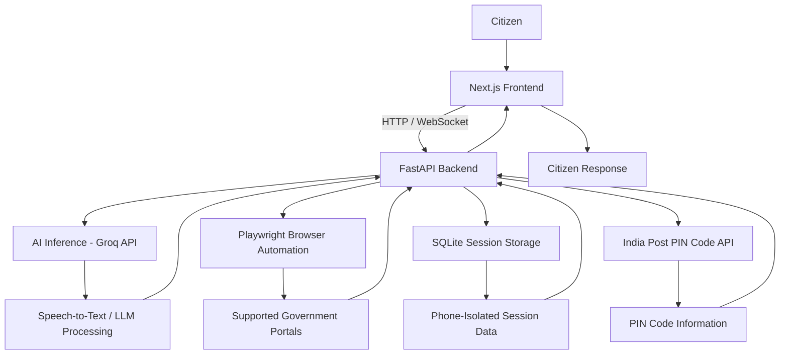

# Jan-Setu: Autonomous Civic Governance & RTI Command Desk

Jan-Setu is an AI-powered civic assistance platform designed to simplify access to public services and Right to Information (RTI) processes. It uses an agentic AI workflow to help citizens navigate government service portals, retrieve relevant information, and complete supported online tasks through an accessible interface.

## Problem Statement

Accessing government services and filing RTI requests can be difficult for citizens because information is often spread across multiple portals, processes can be confusing, and users may struggle with complicated forms and navigation.

Citizens may also face language and technical barriers when trying to understand eligibility requirements, locate service information, or complete online procedures.

## Our Solution

Jan-Setu provides a conversational civic assistance interface backed by an AI agent that can understand user requests and assist with supported workflows.

The platform combines:

- **AI-powered interaction:** Understands user requests and helps guide them through civic-service workflows.
- **Browser automation:** Uses Playwright to interact with supported web portals.
- **Voice support:** Uses speech-to-text capabilities to make interaction more accessible.
- **Session persistence:** Maintains phone-isolated session data using SQLite.
- **PIN code lookup:** Integrates with the India Post PIN Code API to retrieve location-related postal information.
- **Real-time communication:** Uses WebSockets to support communication between the frontend and backend.

## Technical Architecture

Jan-Setu follows a frontend-backend architecture. The Next.js frontend communicates with a FastAPI backend, which coordinates AI inference, browser automation, external API requests, and session persistence.



### Architecture Components

| Component | Responsibility |
|---|---|
| Next.js Frontend | Provides the user interface and handles user interaction. |
| FastAPI Backend | Coordinates requests, AI processing, automation, and external integrations. |
| Groq API | Provides speech recognition and language-model inference. |
| Playwright | Automates supported browser-based workflows. |
| SQLite | Stores session data with phone-based isolation. |
| India Post API | Retrieves PIN code and postal-location information. |
| WebSockets | Enables real-time communication between frontend and backend. |

## Tech Stack

### Frontend
- Next.js
- TypeScript
- Tailwind CSS
- Lucide Icons

### Backend
- Python
- FastAPI
- Uvicorn
- WebSockets

### Agentic Framework
- Playwright
- Asynchronous Chromium browser automation

### AI & Inference
- Groq API
- `whisper-large-v3-turbo`
- `openai/gpt-oss-20b`
- `llama-3.3-70b-versatile`

### Database
- SQLite
- Phone-isolated session persistence

### External APIs
- India Post PIN Code API: https://api.postalpincode.in

## Project Setup & Installation

Follow these instructions to run Jan-Setu locally.

### Prerequisites

Make sure the following tools are installed:

- Python 3.10+
- Node.js and npm
- Git

### 1. Clone the Repository

```bash
git clone <YOUR_REPOSITORY_URL>
cd <YOUR_PROJECT_DIRECTORY>
```

Replace the placeholders with your repository URL and project directory name.

### 2. Backend Setup

Navigate to the backend directory:

```bash
cd backend
```

Create a Python virtual environment:

```bash
python -m venv venv
```

Activate the virtual environment.

**Linux / macOS:**

```bash
source venv/bin/activate
```

**Windows:**

```bash
venv\Scripts\activate
```

Install the required Python dependencies:

```bash
pip install fastapi uvicorn playwright groq websockets python-dotenv python-multipart pydantic pillow httpx
```

Install the Chromium browser required by Playwright:

```bash
playwright install chromium
```

### 3. Configure Environment Variables

Create a `.env` file inside the backend directory:

```env
GROQ_API_KEY=your_groq_api_key_here
```

Replace `your_groq_api_key_here` with your actual Groq API key.

### 4. Start the Backend Server

Run the FastAPI application:

```bash
uvicorn main:app --reload --port 8000
```

The backend server will be available at:

```text
http://localhost:8000
```

### 5. Frontend Setup

Open a new terminal and navigate to the frontend directory:

```bash
cd frontend
```

Install the dependencies:

```bash
npm install
```

Start the Next.js development server:

```bash
npm run dev
```

Open the application in your browser:

```text
http://localhost:3000
```

## Environment Variables

| Variable | Description |
|---|---|
| `GROQ_API_KEY` | API key used for Groq inference services. |

Keep your API credentials private. Never commit your `.env` file or expose API keys in frontend code.

## Running the Application

Once both servers are running:

1. Start the FastAPI backend on port `8000`.
2. Start the Next.js frontend on port `3000`.
3. Open `http://localhost:3000` in your browser.
4. Interact with the Jan-Setu interface to explore its supported civic assistance workflows.

## Security Notes

- Store API keys and other secrets in environment variables.
- Do not commit `.env` files to version control.
- Keep session data isolated between users.
- Use browser automation only for supported and authorized workflows.
- Review automated actions before submitting forms or making official requests.

## License

Add the applicable license information here before distributing the project.
